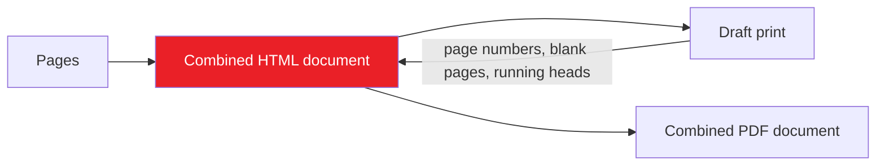

# Combining pages

The aggregator combines pages into a single PDF document. The pages are assembled into a single HTML document, printed once by the browser:



```yaml
plugins:
  - exporter:
      formats:
        pdf:
          aggregator:
            enabled: true
            output: documentation.pdf
            covers: limits
            metadata:
              title: Documentation
              author: Jane Doe
```

Pages are combined in the order of the navigation, and numbered across the whole document: `{page}` and `{pages}` in [headers and footers](headers-and-footers.md), as well as `counter(page)` and `counter(pages)` in your own stylesheets, count the pages of the combined document.
The document's title, author and subject default to the website's (`site_name`, `site_author` and `site_description`).

Each page keeps its own `{page_title}` and `{section}`; the pages of the table of contents show its title.
What the browser can't print by itself (the page numbers of the table of contents, blank pages and `{section}`) is computed from a first print of the document's layout, then the document is printed again.

### In a single document

Since every page is part of the same HTML document:

- each page starts on a new page;
- identifiers are prefixed by page (e.g. `p2-installation`), so that footnotes, tabs and other references of different pages don't interfere: stylesheets and scripts targeting identifiers of the content (`#installation`) don't match them in combined documents;
- stylesheets and scripts loaded by some pages only are loaded once for the whole document, and the scripts of [`formats.pdf.scripts`](customizing-documents.md#scripts) run once;
- `@page :first` rules apply to the pages of front covers (in a page's own document, its first page is its front cover);
- styles teleported to the head by cover pages (`<style data-teleport="head">`) are included once when they are the same for every page; otherwise they only apply to their own page.

## Cover pages

The `covers` option tells which cover pages are kept:

- `all` (*default*): every cover page;
- `none`: no cover page;
- `limits`: the front cover of the first page and the back cover of the last page;
- `book`: the front cover of every page and the back cover of the last page;
- `front`: every front cover page;
- `back`: every back cover page.

## Bookmarks and links

The combined document has bookmarks following the navigation: sections, pages and their headings (`h2`, `h3`).
Their depth can be changed, or set to `0` to disable them:

```yaml
aggregator:
  enabled: true
  outline: 2
```

Links between pages of the combined document point within the document, to the linked heading when there is one.
Other links point to the website (`site_url` or `formats.pdf.url`), or are relative to the combined document when the website has no URL.

## Table of contents

A table of contents can be inserted after the first front cover:

```yaml
aggregator:
  enabled: true
  toc:
    enabled: true
    title: Contents
    depth: 2 # Pages and their second-level headings
```

Its appearance can be changed with CSS (`.mkdocs-exporter-toc` and the classes of the default [template](https://github.com/adrienbrignon/mkdocs-exporter/blob/master/mkdocs_exporter/core/resources/toc.html)), or replaced with a Jinja template of your own (`toc.template`), receiving `title` and `entries` (each entry has a `title`, a `page` number, an `href` and `children`).

## Starting pages on the right

For printed books, pages can start on odd (right-hand) pages, blank pages (without headers nor footers) being inserted when needed:

```yaml
aggregator:
  enabled: true
  start: odd
```

## Several documents

`aggregators` defines several combined documents. Patterns select the pages they contain, matched against the path of pages' source files (`*` matches any text, including `/`):

```yaml
plugins:
  - exporter:
      formats:
        pdf:
          aggregators:
            - output: pdf/user-guide.pdf
              include:
                - user-guide/*
            - output: pdf/reference.pdf
              include:
                - reference/*
              exclude:
                - reference/internal/*
```

Every option of `aggregator` is available for each of them.
