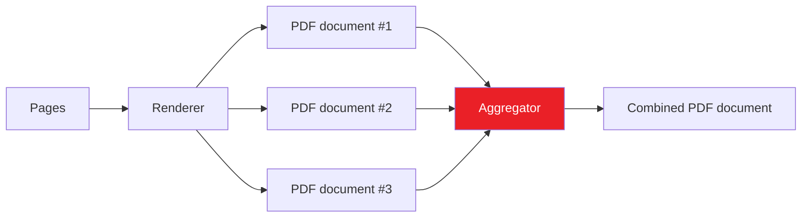

# Combining pages

The aggregator combines pages into a single PDF document:



```yaml
plugins:
  - exporter:
      formats:
        pdf:
          aggregator:
            enabled: true
            output: documentation.pdf
            covers: limits
            metadata:
              title: Documentation
              author: Jane Doe
```

Pages are combined in the order of the navigation, and numbered across the whole document.
The document's title and author default to the website's (`site_name` and `site_author`).

## Cover pages

The `covers` option tells which cover pages are kept:

- `all` (*default*): every cover page;
- `none`: no cover page;
- `limits`: the front cover of the first page and the back cover of the last page;
- `book`: the front cover of every page and the back cover of the last page;
- `front`: every front cover page;
- `back`: every back cover page.

## Bookmarks and links

The combined document has bookmarks following the navigation: sections, pages and their headings (`h2`, `h3`).
Their depth can be changed, or set to `0` to disable them:

```yaml
aggregator:
  enabled: true
  outline: 2
```

Links between pages of the combined document point within the document, to the linked heading when there is one.

## Table of contents

A table of contents can be inserted after the first front cover:

```yaml
aggregator:
  enabled: true
  toc:
    enabled: true
    title: Contents
    depth: 2 # Pages and their second-level headings
```

Its appearance can be changed with CSS (`.mkdocs-exporter-toc` and the classes of the default [template](https://github.com/adrienbrignon/mkdocs-exporter/blob/master/mkdocs_exporter/core/resources/toc.html)), or replaced with a Jinja template of your own (`toc.template`), receiving `title` and `entries` (each entry has a `title`, a `page` number, an `href` and `children`).

## Starting pages on the right

For printed books, pages can start on odd (right-hand) pages, blank pages being inserted when needed:

```yaml
aggregator:
  enabled: true
  start: odd
```

## Several documents

`aggregators` defines several combined documents. Patterns select the pages they contain, matched against the path of pages' source files (`*` matches any text, including `/`):

```yaml
plugins:
  - exporter:
      formats:
        pdf:
          aggregators:
            - output: pdf/user-guide.pdf
              include:
                - user-guide/*
            - output: pdf/reference.pdf
              include:
                - reference/*
              exclude:
                - reference/internal/*
```

Every option of `aggregator` is available for each of them.
