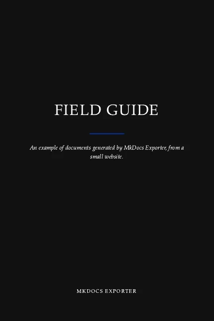
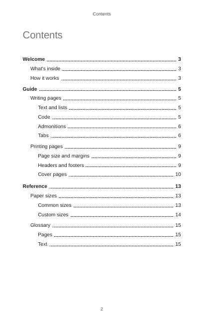
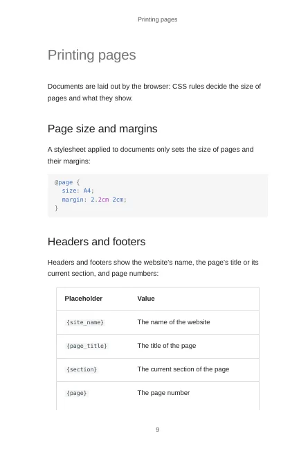

# A printed book

Combine every page into a book of 6 × 9 inches, a common size of printed books: a framed cover, a table of contents and bookmarks, chapters starting on right-hand pages, and wider inner margins for binding.

=== "`mkdocs.yml`"

    {{ example("book/mkdocs.yml") }}

=== "`pdf.css`"

    {{ example("book/pdf.css") }}

=== "`covers/front.html.j2`"

    {{ example("book/covers/front.html.j2") }}

- The [aggregator](../configuration/combining-pages.md) combines the pages, in the order of the navigation, into `field-guide.pdf`.
- `covers: limits` only keeps the front cover of the first page (and the back cover of the last page, if there was one): the cover of the home page is the cover of the book. The template shows the website's description on the home page, and the page's title on the other pages' own documents.
- `toc` inserts the table of contents after the cover, and `outline` sets the depth of bookmarks (pages and their second-level headings).
- `start: odd` starts every chapter on a right-hand page, inserting blank pages (without headers nor footers) when needed.
- `{page_title}` shows the title of the chapter, and `{page}` numbers the pages of the whole book.
- `@page :right` and `@page :left` mirror the margins of right-hand and left-hand pages.
- The frame of the cover is the background of its page ([`/assets/frame.svg`](https://github.com/adrienbrignon/mkdocs-exporter/blob/master/examples/content/assets/frame.svg), stretched to the page), so it doesn't depend on the space the theme leaves above the content.

[:material-github: Browse the files of this example](https://github.com/adrienbrignon/mkdocs-exporter/tree/master/examples/book)
