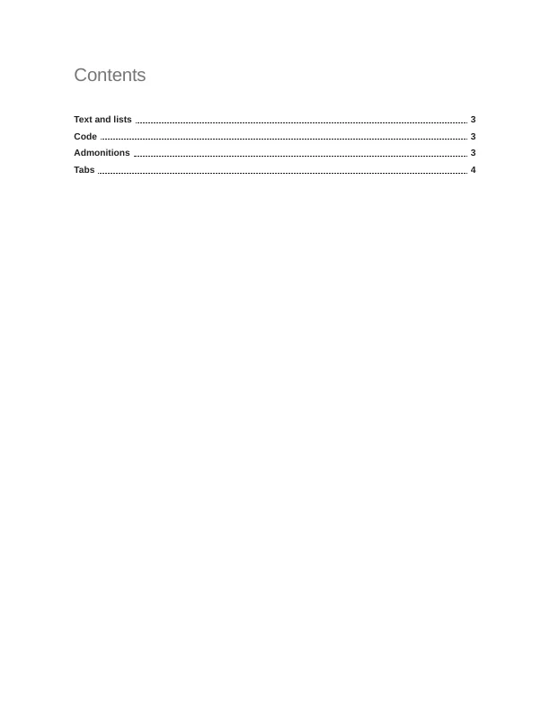

# Cover pages

Start each document with a full-bleed cover showing the page's title, its description and the version of the website, followed by a table of contents.

<div class="previews" markdown>

[](../assets/images/examples/cover-pages-1.webp)
[](../assets/images/examples/cover-pages-2.webp)

</div>

=== "`mkdocs.yml`"

    {{ example("cover-pages/mkdocs.yml") }}

=== "`covers/front.html.j2`"

    {{ example("cover-pages/covers/front.html.j2") }}

=== "A page"

    ```markdown
    ---
    description: Text, lists, code, admonitions, tabs and footnotes, as they are printed.
    ---

    # Writing pages
    ```

- The front cover is a [Jinja template](../configuration/generating-pdf-documents.md#cover-pages), rendered for each page: `page` is the page (`page.title`, `page.meta` for its front matter), and `extra` the `extra` settings of `mkdocs.yml`.
- `<style data-teleport="head">` moves the template's styles to the head of the document: its `@page :first` rule removes the margins of the first page and covers it with an illustration ([`/assets/cover.svg`](https://github.com/adrienbrignon/mkdocs-exporter/blob/master/examples/content/assets/cover.svg)). The content of the cover stays in the flow of the page: drawing decorations in the background of the page keeps them in place, whatever the space the theme leaves above the content.
- Paths starting with `/` (`/assets/cover.svg`) are resolved from the root of the website.
- `toc` inserts a [table of contents](../configuration/generating-pdf-documents.md#table-of-contents) of the page's headings after the front cover, with their page numbers.

A page can use another cover, or none, in its front matter:

=== "Another cover"

    ```yaml
    ---
    covers:
      front: covers/release-notes.html.j2
    ---
    ```

=== "No cover"

    ```yaml
    ---
    hide:
      - covers
    ---
    ```

[:material-github: Browse the files of this example](https://github.com/adrienbrignon/mkdocs-exporter/tree/master/examples/cover-pages)
