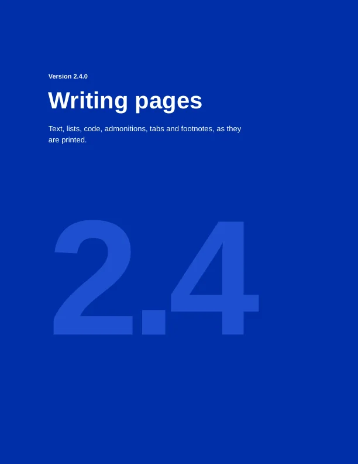
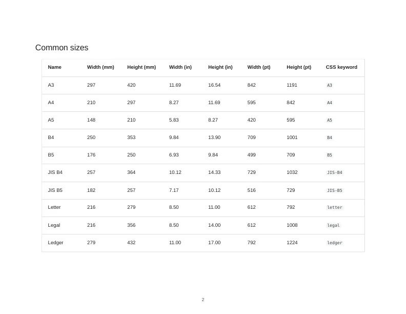
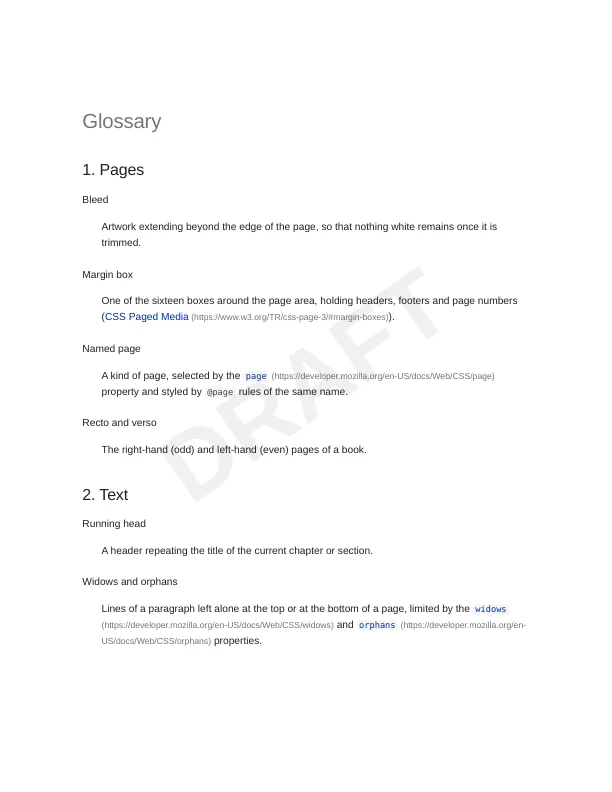
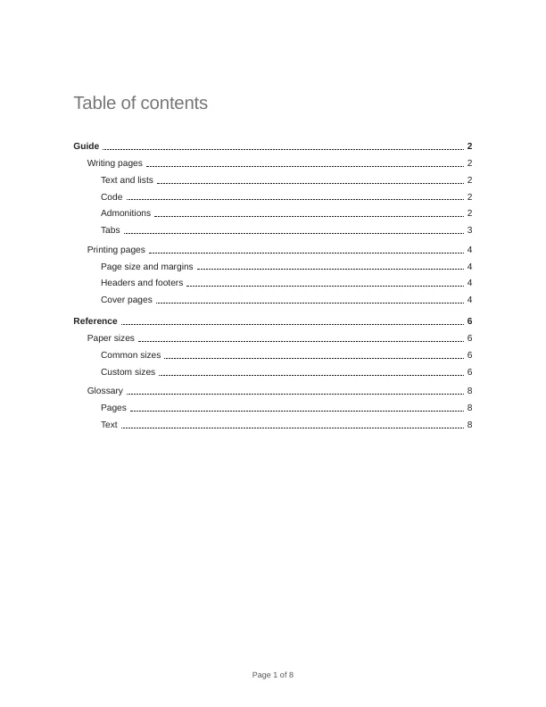

# Examples

Each example is a small project printing the same website, the *Field Guide*: five pages written with Material for MkDocs.
Click a preview to open its document at that page.
The files shown are the ones the pictured documents are generated from, and the examples are built by the tests of the plugin, so they keep working.

Their `mkdocs.yml` only shows what they add to the website's settings, shared by every example ([`examples/base.yml`](https://github.com/adrienbrignon/mkdocs-exporter/blob/master/examples/base.yml)).

## The Field Guide

A complete example: every page gets a document with a cover, a table of contents and headers and footers, and the pages are combined into a single document.

{{ previews("field-guide:1", "field-guide:2", "field-guide:3") }}
[:material-github: Browse the project](https://github.com/adrienbrignon/mkdocs-exporter/tree/master/examples/field-guide){ .md-button }

=== "`mkdocs.yml`"

    {{ example("field-guide/mkdocs.yml") }}

=== "`pdf.css`"

    {{ example("field-guide/pdf.css") }}

=== "`covers/front.html.j2`"

    {{ example("field-guide/covers/front.html.j2") }}

=== "`covers/back.html.j2`"

    {{ example("field-guide/covers/back.html.j2") }}

- The front cover is laid out like a manual page, from the page itself: its title (`page.title`), its description (`page.meta.description`), its sections (`page.toc`) and the other pages of its section (`page.parent.children`).
- The front cover of the home page is the cover of the book (`covers: limits`): on that page, the template shows the website's name and description instead (`page.is_homepage`).
- The back cover is printed on a named page (`page: colophon`), which leaves out the header and the footer itself (`content: none` for each of them): the plugin only leaves them out of its own cover pages.

## Themes

The same page, printed with the [`material`](https://squidfunk.github.io/mkdocs-material/) and [`readthedocs`](https://www.mkdocs.org/user-guide/choosing-your-theme/#readthedocs) themes:

{{ previews("field-guide:4", "field-guide-readthedocs") }}

Other themes are supported on a best-effort basis: their navigation is hidden by generic rules, which a [stylesheet](../configuration/customizing-documents.md#stylesheets) can complete.

## Content

How diagrams, mathematics and images are printed, with the configuration of this documentation (each page has a PDF document):

- [Diagrams](content/diagrams.md), drawn by [Mermaid](https://mermaid.js.org/);
- [Mathematics](content/mathematics.md), typeset by [MathJax](https://www.mathjax.org/) and [KaTeX](https://katex.org/);
- [Multimedia](content/multimedia.md): images, in various formats.

## Recipes

-   [{ .thumbnail }](page-numbers.md)

    __[Page numbers](page-numbers.md)__

    Headers and footers with the website's name, the current section and page numbers.

-   [{ .thumbnail }](cover-pages.md)

    __[Cover pages](cover-pages.md)__

    A full-bleed front cover showing the page's metadata, followed by a table of contents.

-   [{ .thumbnail }](book.md)

    __[A printed book](book.md)__

    Every page combined into a book, with a cloth-like cover, a table of contents, bookmarks and chapters starting on the right.

-   [{ .thumbnail }](page-layout.md)

    __[Paper size and landscape pages](page-layout.md)__

    US Letter pages, and landscape pages for wide tables.

-   [{ .thumbnail }](print-styles.md)

    __[Print styles](print-styles.md)__

    Numbered headings, the addresses of links, a watermark, and content for the website or documents only.

-   [{ .thumbnail }](documents.md)

    __[One document per section](documents.md)__

    Several books, selecting pages with patterns.

