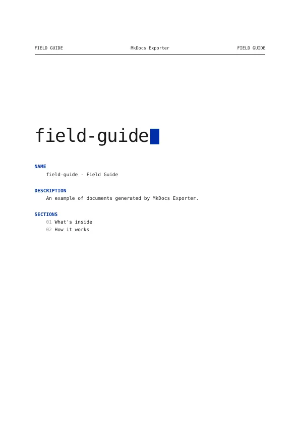
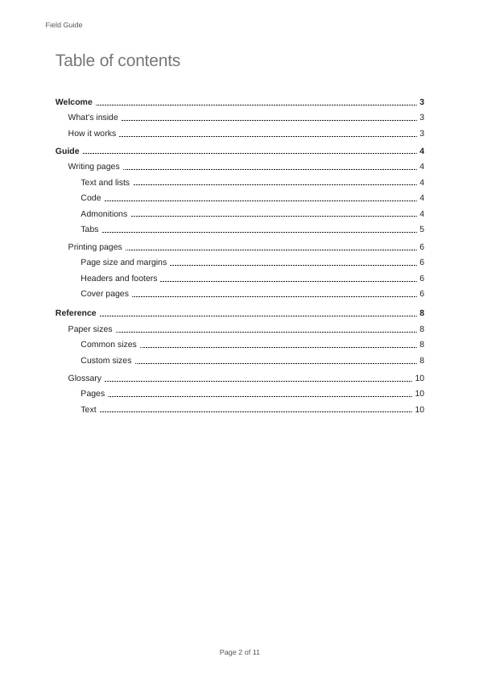
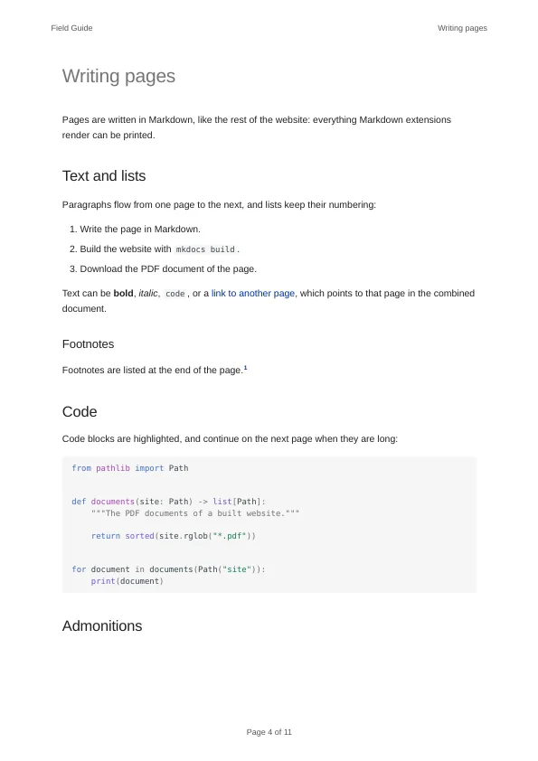
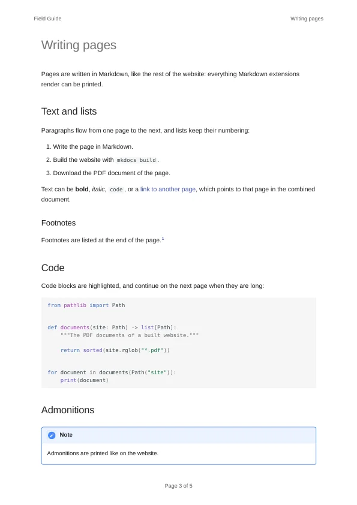
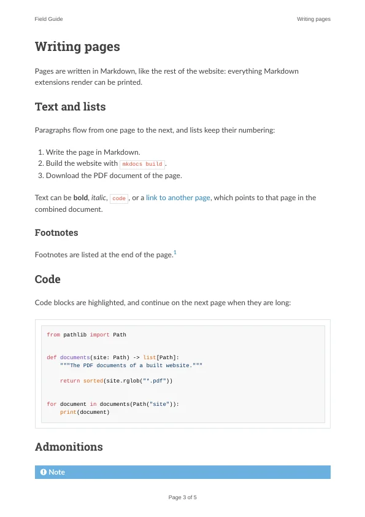
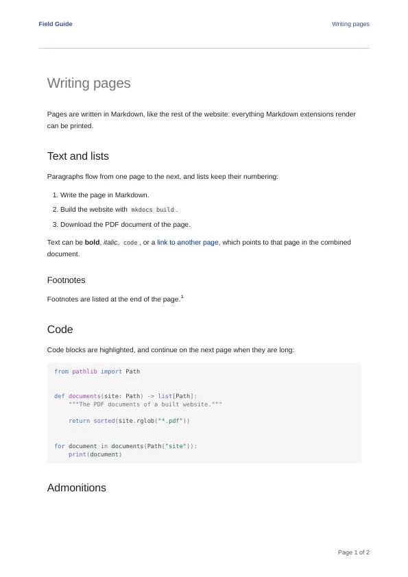
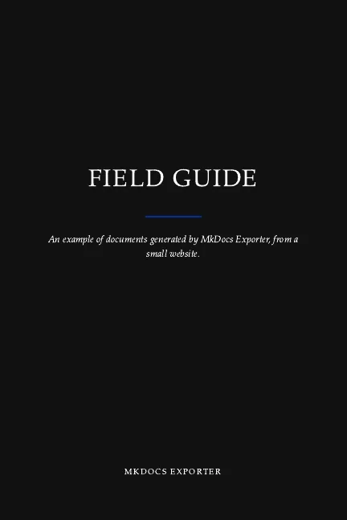

# Examples

Each example is a small project printing the same website, the *Field Guide*: five pages written with Material for MkDocs.
The files shown are the ones the pictured documents are generated from, and the examples are built by the tests of the plugin, so they keep working.

Their `mkdocs.yml` only shows what they add to the website's settings, shared by every example ([`examples/base.yml`](https://github.com/adrienbrignon/mkdocs-exporter/blob/master/examples/base.yml)).

## The Field Guide

A complete example: every page gets a document with a cover, a table of contents and headers and footers, and the pages are combined into a single document.

[:material-file-pdf-box: Open the combined document](https://github.com/adrienbrignon/mkdocs-exporter/blob/master/examples/field-guide.pdf){ .md-button }
[:material-github: Browse the project](https://github.com/adrienbrignon/mkdocs-exporter/tree/master/examples/field-guide){ .md-button }

=== "`mkdocs.yml`"

    {{ example("field-guide/mkdocs.yml") }}

=== "`pdf.css`"

    {{ example("field-guide/pdf.css") }}

=== "`covers/front.html.j2`"

    {{ example("field-guide/covers/front.html.j2") }}

=== "`covers/back.html.j2`"

    {{ example("field-guide/covers/back.html.j2") }}

- The front cover of the home page is the cover of the combined document (`covers: limits`): on that page, the template shows the website's name and description (`page.is_homepage`). Other pages show their section (`page.parent`) above their title.
- The covers are printed on a contour map ([`/assets/contours.svg`](https://github.com/adrienbrignon/mkdocs-exporter/blob/master/examples/content/assets/contours.svg)), the background of their page: `@page :first` for the front cover, and a named page (`page: back-cover`) for the back cover.
- Headers and footers are left out of cover pages, but a named page of your own needs to leave them out itself (`content: none` for each of them).

## Themes

The same page, printed with the [`material`](https://squidfunk.github.io/mkdocs-material/) and [`readthedocs`](https://www.mkdocs.org/user-guide/choosing-your-theme/#readthedocs) themes:

Other themes are supported on a best-effort basis: their navigation is hidden by generic rules, which a [stylesheet](../configuration/customizing-documents.md#stylesheets) can complete.

## Recipes

-   [{ .thumbnail }](page-numbers.md)

    __[Page numbers](page-numbers.md)__

    Headers and footers with the website's name, the current section and page numbers.

-   [{ .thumbnail }](cover-pages.md)

    __[Cover pages](cover-pages.md)__

    A full-bleed front cover showing the page's metadata, followed by a table of contents.

-   [{ .thumbnail }](book.md)

    __[A printed book](book.md)__

    Every page combined into a book, with a framed cover, a table of contents, bookmarks and chapters starting on the right.

-   [{ .thumbnail }](page-layout.md)

    __[Paper size and landscape pages](page-layout.md)__

    US Letter pages, and landscape pages for wide tables.

-   [{ .thumbnail }](print-styles.md)

    __[Print styles](print-styles.md)__

    Numbered headings, the addresses of links, a watermark, and content for the website or documents only.

-   [{ .thumbnail }](documents.md)

    __[One document per section](documents.md)__

    Several combined documents, selecting pages with patterns.

