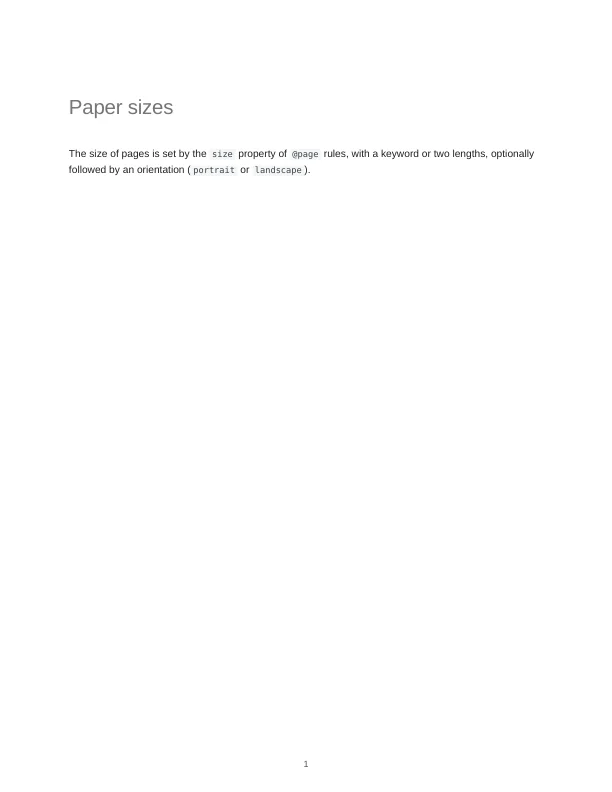
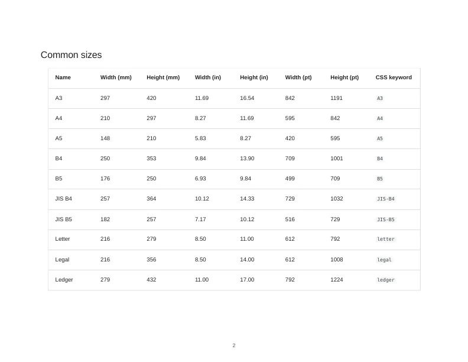

# Paper size and landscape pages

Print documents on US Letter paper, and print wide tables on landscape pages.

<div class="previews" markdown>

[](../assets/images/examples/page-layout-1.webp)
[](../assets/images/examples/page-layout-2.webp)

</div>

=== "`mkdocs.yml`"

    {{ example("page-layout/mkdocs.yml") }}

=== "`pdf.css`"

    {{ example("page-layout/pdf.css") }}

=== "A page"

    ```markdown
    <div class="landscape" markdown>

    ## Common sizes

    | Name | Width (mm) | Height (mm) | Width (in) | Height (in) | ... |
    |---|---|---|---|---|---|
    | A3 | 297 | 420 | 11.69 | 16.54 | ... |

    </div>
    ```

- `size` accepts a keyword (`A4`, `A5`, `letter`, `legal`...), optionally followed by an orientation, or a width and a height (e.g. `size: 6in 9in`).
- `@page landscape` defines a [named page](https://developer.mozilla.org/en-US/docs/Web/CSS/page), used by the elements of the `landscape` class: they start on a new landscape page, and the content following them on a new portrait page.
- The `md_in_html` extension renders the Markdown inside the `<div>`: any block can be given the class, here a section with its heading and its table.
- On the landscape page, the content is laid out with the width of that page, so the table fits.

[:material-github: Browse the files of this example](https://github.com/adrienbrignon/mkdocs-exporter/tree/master/examples/page-layout)
