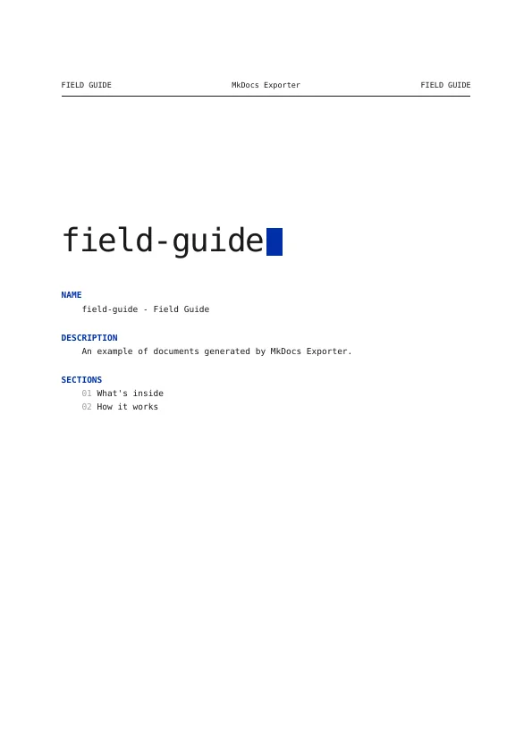
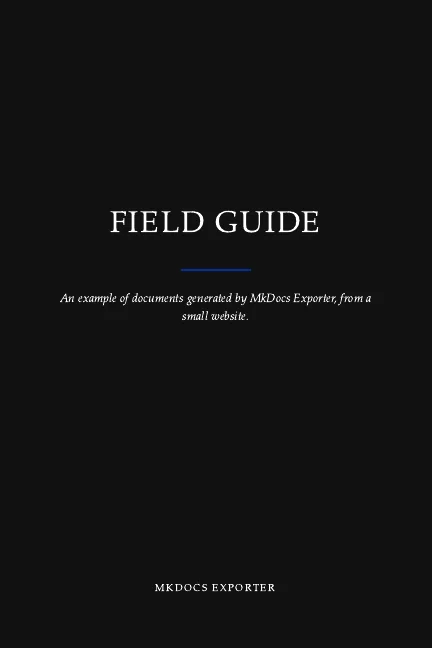

---
hide:
  - navigation
---

# Getting started

## Introduction

[MkDocs Exporter](https://github.com/adrienbrignon/mkdocs-exporter) exports the pages of your [MkDocs](https://www.mkdocs.org/) or [ProperDocs](https://github.com/ProperDocs/properdocs) website to PDF documents, and combines them into books: single documents with bookmarks, a table of contents and working links.
Websites built by [Zensical](https://zensical.org/) can be exported too (experimental).

Documents are printed by a headless Chromium browser driven by [Playwright](https://playwright.dev/python/), which supports [CSS Paged Media](https://www.w3.org/TR/css-page-3/): page sizes, margins, headers and footers, page counters...

## Examples

- <a href="../documentation.pdf">__Read__ this documentation in the PDF format</a>
- <a href="index.pdf">__View__ this page in the PDF format</a>
- [__Browse__ the examples](examples/index.md): documents generated from a small website, with their configuration

<div class="previews" markdown>

[](examples/index.md)
[](examples/index.md)
[](examples/index.md)
[](examples/book.md)

</div>

## Prerequisites

- Python `>= 3.11.5`, on Linux, macOS or Windows
- MkDocs `>= 1.6, < 2` or [ProperDocs](https://github.com/ProperDocs/properdocs)
- Chromium `>= 138`, installed with Playwright (see below), or Chrome / Edge with [`browser.channel`](guide/documents.md#browser)
- A theme: [`material`](https://github.com/squidfunk/mkdocs-material) (:material-star-shooting: *used by this documentation*) and [`readthedocs`](https://www.mkdocs.org/user-guide/choosing-your-theme/#readthedocs) have dedicated support, other themes are supported on a best-effort basis.

??? info "What about MkDocs 2.0 and Zensical?"

    MkDocs 2.0 no longer supports plugins and Zensical ignores MkDocs plugins it doesn't know about, so this plugin can't run there.
    Websites built by Zensical can be exported by a command run once they are built (experimental), see [Zensical](how-to/zensical.md).

## Installation

Install the plugin with the package manager of your choice:

```bash
pip install "mkdocs-exporter>=7.0.0rc1"
```

!!! note "Release candidate"

    Version 7 is a release candidate: until 7.0.0 is released, package managers only install it when asked for a pre-release, as above (`pip install mkdocs-exporter` installs 6.2.0).

Then install the browser used to print documents:

```bash
playwright install --with-deps --only-shell chromium
```

On Linux, `--with-deps` also installs the system libraries the browser needs, which requires administrator rights (leave it out when they're installed already).
If the `playwright` command isn't found, run `python -m playwright install --with-deps --only-shell chromium` with the Python that runs MkDocs.

## Generating documents

Register the plugin in your configuration file:

```yaml
plugins:
  - exporter
```

That's it: `mkdocs build` (or `properdocs build -f mkdocs.yml`) now generates a PDF document next to each page (e.g. `site/guide/index.pdf` for `site/guide/index.html`).
Documents are not generated by `mkdocs serve` (to keep the preview fast), unless you [ask for it](guide/documents.md#while-serving).

Unchanged documents are reused from a cache, in `.cache/plugin/exporter` next to `mkdocs.yml`: add `.cache/` to your `.gitignore`.

## Adding a download button

Readers can download the document of a page with a button at the top of the page:

```yaml
plugins:
  - exporter:
      buttons:
        - title: Download as PDF
          icon: material-file-download-outline
          enabled: !!python/name:mkdocs_exporter.formats.pdf.buttons.download.enabled
          attributes: !!python/name:mkdocs_exporter.formats.pdf.buttons.download.attributes
```

See [Adding buttons to pages](guide/buttons.md) for other buttons (e.g. downloading a book).

## Making a book

A book combines the pages of your website into a single document, following the navigation:

```yaml
plugins:
  - exporter:
      formats:
        pdf:
          books:
            - output: documentation.pdf
              toc:
                enabled: true
```

See [Books](guide/books.md) for cover pages, several books, and pages starting on the right.

## Next steps

- Give documents [cover pages](guide/cover-pages.md) and [headers and footers](guide/headers-and-footers.md) (e.g. page numbers).
- Style them with [stylesheets of their own](guide/styles-and-scripts.md).
- Browse the [examples](examples/index.md): documents generated from a small website, with their configuration.
- Build documents on CI with the [continuous integration guide](how-to/continuous-integration.md), and check [Troubleshooting](how-to/troubleshooting.md) if something goes wrong.
