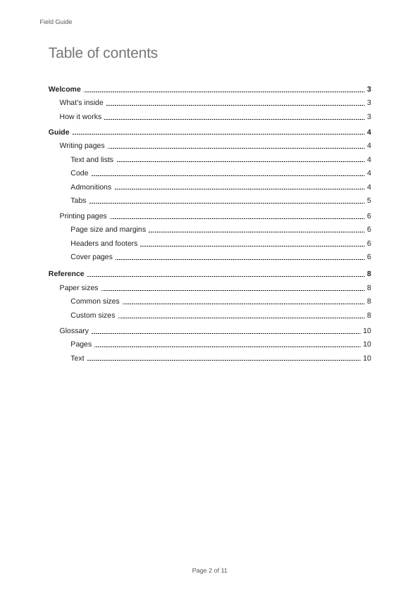
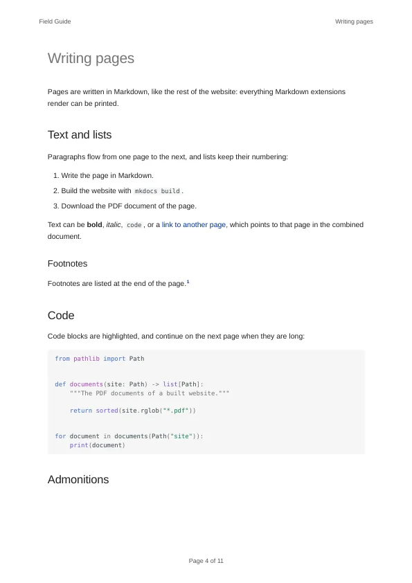

---
hide:
  - navigation
---

# Getting started

## Introduction

[MkDocs Exporter](/) is a plugin for [MkDocs](https://www.mkdocs.org/) that exports your pages to PDF documents and can combine them into a single document, with bookmarks, a table of contents and working links.

Documents are printed by a headless Chromium browser driven by [Playwright](https://playwright.dev/python/), which supports [CSS Paged Media](https://www.w3.org/TR/css-page-3/): page sizes, margins, headers and footers, page counters...

## Examples

- <a href="../documentation.pdf">__Read__ this documentation in the PDF format</a>
- <a href="index.pdf">__View__ this page in the PDF format</a>
- [__Browse__ the examples](examples/index.md): documents generated from a small website, with their configuration

<div class="previews" markdown>

[](examples/index.md)
[](examples/index.md)
[](examples/index.md)
[](examples/book.md)

</div>

## Prerequisites

- Python `>= 3.11`
- MkDocs `>= 1.6, < 2` or [ProperDocs](https://github.com/ProperDocs/properdocs)
- Chromium `>= 138`, installed with Playwright (see below), or Chrome / Edge with [`browser.channel`](configuration/customizing-documents.md#browser)
- A theme: [`material`](https://github.com/squidfunk/mkdocs-material) (:material-star-shooting: *used by this documentation*) and [`readthedocs`](https://www.mkdocs.org/user-guide/choosing-your-theme/#readthedocs) have dedicated support, other themes are supported on a best-effort basis.

??? info "What about MkDocs 2.0 and Zensical?"

    MkDocs 2.0 no longer supports plugins and Zensical ignores MkDocs plugins it doesn't know about, so this plugin can't run there.
    The rendering engine of *MkDocs Exporter* doesn't depend on MkDocs though, and a standalone command able to export any built website is planned.

## Installation

Install the plugin with the package manager of your choice:

```bash
pip install mkdocs-exporter
```

Then install the browser used to print documents (`--with-deps` also installs the system libraries it needs on Linux):

```bash
playwright install --with-deps --only-shell chromium
```

Register the plugin in your configuration file:

```yaml
plugins:
  - exporter
```

That's it: `mkdocs build` (or `properdocs build`) now generates a PDF document next to each page.
Documents are not generated by `mkdocs serve` (to keep the preview fast), unless you [ask for it](configuration/generating-pdf-documents.md#while-serving).

Check out the [configuration guides](configuration/generating-pdf-documents.md) and the [examples](examples/index.md) to customize your documents, and the [continuous integration guide](guides/continuous-integration.md) to build them on CI.
