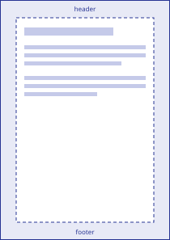

# Printing pages

Documents are laid out by the browser: CSS rules decide the size of pages and what they show.

## Page size and margins

A stylesheet applied to documents only sets the size of pages and their margins:

```css
@page {
  size: A4;
  margin: 2.2cm 2cm;
}
```

## Headers and footers

Headers and footers show the website's name, the page's title or its current section, and page numbers:

| Placeholder | Value |
|---|---|
| `{site_name}` | The name of the website |
| `{page_title}` | The title of the page |
| `{section}` | The current section of the page |
| `{page}` | The page number |
| `{pages}` | The number of pages |

## Cover pages

Cover pages are templates, rendered for every page: the front cover of this document shows the page's title on a page of its own color.

### Front cover

The front cover is the first page of each document.

### Back cover

The back cover ends each document; in the combined document, only the first front cover and the last back cover are kept.

{ width="240" }
